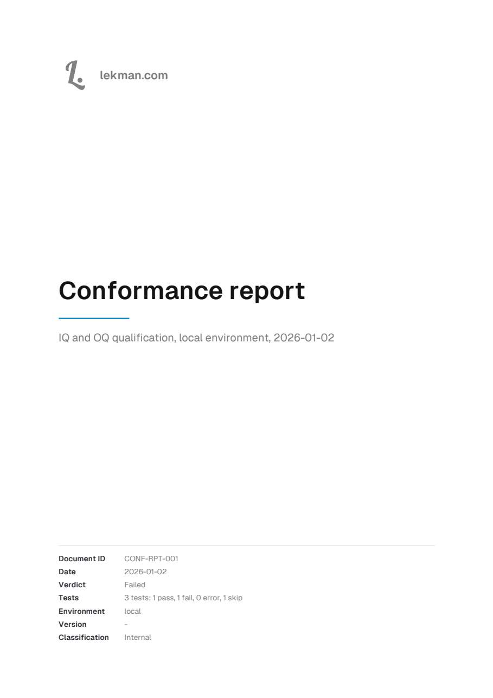
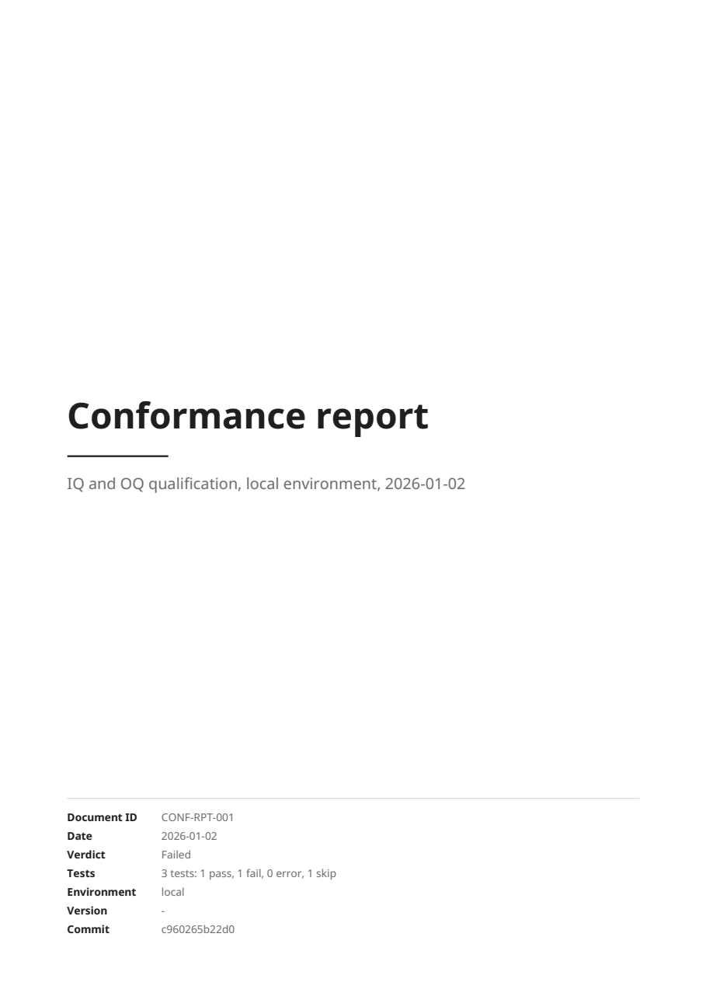
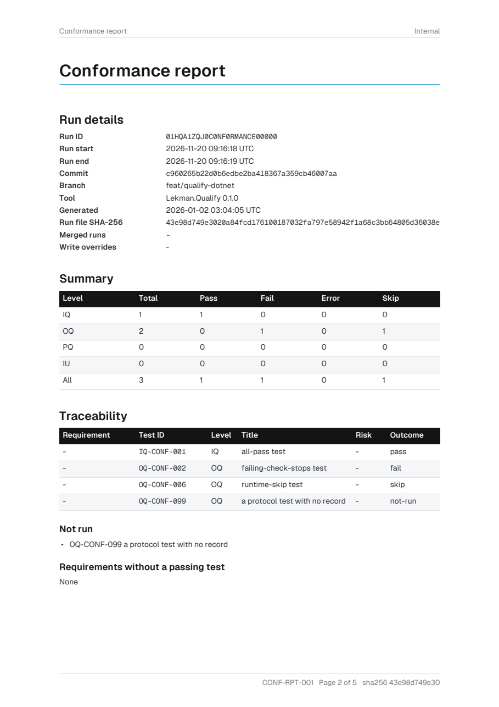
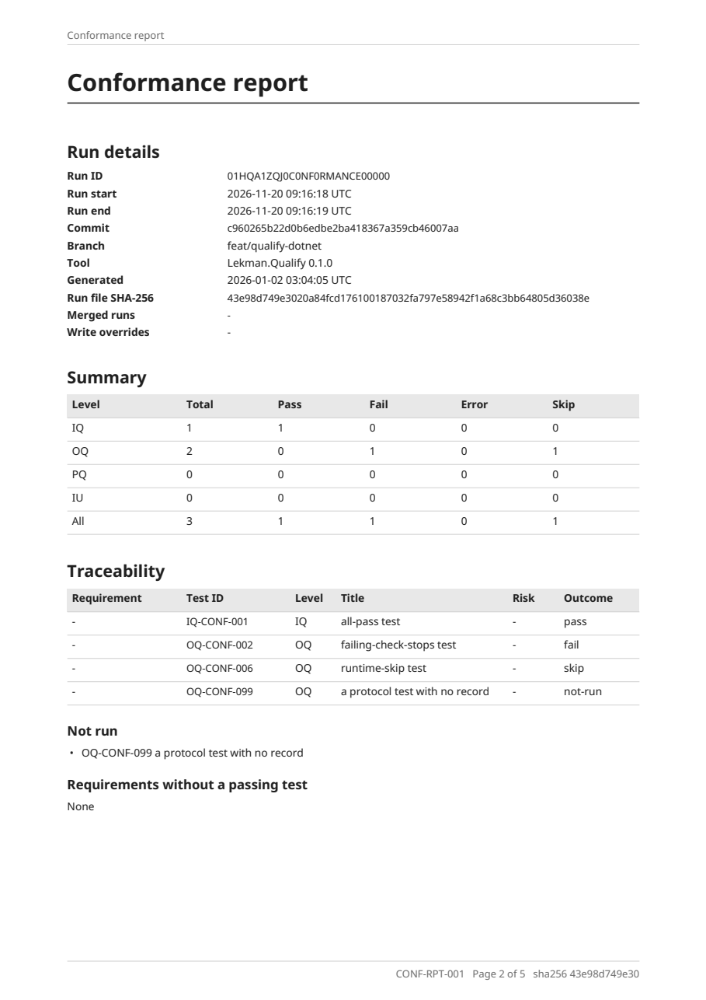
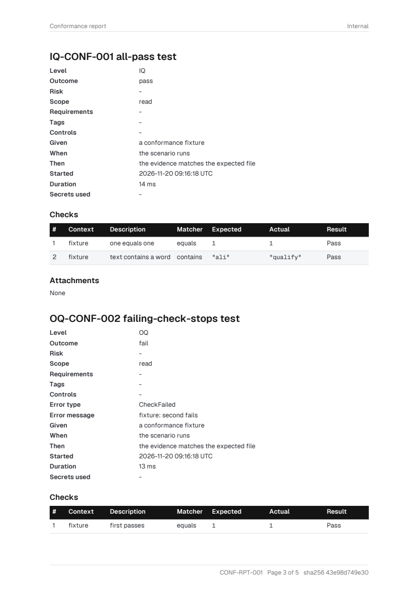
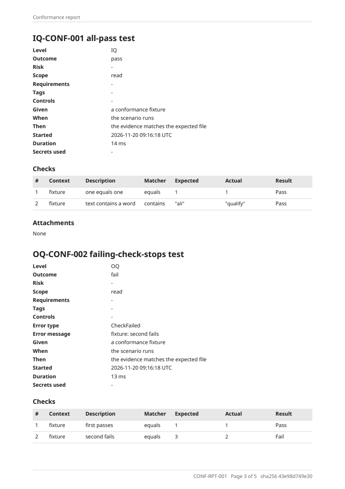

# Lekman.Qualify

> Qualification tests (IQ, OQ, PQ, intended use) for xUnit v3 on .NET 10 and
> 11 that leave redacted JSON evidence, and a `qualify` .NET tool that merges
> it, validates it and renders the qualification report as a PDF.

This is the C# implementation of the
[qualify specification](../../spec/qualify/README.md). It writes the same
evidence files as the TypeScript reference, [@lekman/qualify](../qualify-ts/README.md),
byte for byte, and passes the same 22 conformance scenarios. It is not
published yet.

## Why

A passing test run says that the tests passed. It does not say what each test
claimed, what it checked, which requirement it covers, or where it ran, and it
cannot be read six months later without the code. A qualification test here is
an ordinary xUnit test with an ID, a narrative (given, when, then) and recorded
checks. When it runs, the process that ran it writes one JSON record, with
secrets already removed. `qualify merge` builds one run file from the records,
and `qualify report` turns it into a PDF a reviewer can sign.

xUnit still runs the tests. There is no wrapper command: select tests with the
runner's own filters.

## Install

```bash
dotnet add package Lekman.Qualify
dotnet tool install --global Lekman.Qualify.Tool   # the qualify command
```

The test project uses xUnit v3 (`xunit.v3` 4.x) on the Microsoft Testing
Platform:

```xml
<PropertyGroup>
  <TargetFramework>net10.0</TargetFramework>
  <OutputType>Exe</OutputType>
  <UseMicrosoftTestingPlatformRunner>true</UseMicrosoftTestingPlatformRunner>
</PropertyGroup>
```

and `global.json` opts `dotnet test` into the Microsoft Testing Platform:

```json
{ "test": { "runner": "Microsoft.Testing.Platform" } }
```

## A Qualification Test

```csharp
using Lekman.Qualify;

public class BankFileTests
{
    [OQ("OQ-EXPORT-003", "The bank file never changes an amount",
        Given = "a day of payments in three currencies",
        When = "the export writes the bank file",
        Then = "every amount in the file equals the amount in the ledger",
        Requirements = ["EXPORT-003"], Risk = Risk.High, Scope = Scope.Read,
        Tags = ["export"])]
    public async Task BankFileKeepsAmounts()
    {
        var ctx = QualifyContext.Current;
        var file = await BankFile.ExportAsync(ledger);
        ctx.Check("bank file", "EUR keeps two decimals").That(file.Amount("EUR")).IsEqualTo("100.50");
    }
}
```

- `[IQ]`, `[OQ]`, `[PQ]` and `[IU]` derive from xUnit's `FactAttribute`, so
  `Skip`, `Timeout` and `Explicit` work as on any fact. IQ is always `read` and
  IU always `read-write`; OQ and PQ must declare `Scope`.
- xUnit facts take no parameters, so the test reads its context from
  `QualifyContext.Current`, an `AsyncLocal` that stays set across `await`.
- A declaration error (a bad ID, a missing `Scope`, an empty `Given`) fails the
  test at discovery with every problem listed, and writes no evidence.
- The display name is `[<ID>] <title>`. The test carries the traits `Qualify`
  (the level) and `Tag` (each tag).

### The Context

| Member                                | What it does                                                          |
| ------------------------------------- | --------------------------------------------------------------------- |
| `Id`, `Level`, `Environment`          | Identity, and where the test runs                                     |
| `Check(context, description)`         | Start a hard check: a failure records itself and ends the test        |
| `Check(...).Soft()`                   | A soft check: record, keep going, fail at the end                     |
| `Delegate(context, description, fn)`  | Run `fn` (or `DelegateAsync` for a task) and record it as one check   |
| `Attach(filename, body, contentType)` | Add an attachment: a string, bytes, or a value for `application/json` |
| `Secret(name)`                        | Read `QUALIFY_SECRET_<NAME>` and register it for redaction            |
| `Redact(value)`                       | Register a value for redaction                                        |
| `Skip(reason)`                        | Skip at runtime; xUnit reports the test as skipped                    |
| `RunContext(extra)`                   | Attach `run-context.json` with the run's source, actor and target     |

Matchers follow C# names and record the shared JSON names: `IsEqualTo`
(`equals`), `IsNotEqualTo`, `Contains`, `Matches`, `IsTrue`, `IsFalse`,
`IsNull`, `IsNotNull`, `HasLength`, `IsAtLeast` (`atLeast`), `IsAtMost` and
`IsOneOf` (`oneOf`). `Matches` uses .NET regular expressions.

Outcomes: a failed check is `fail` with type `CheckFailed`; xUnit's own
assertions (the `XunitException` family) and failed `Debug.Assert` calls are
`fail` with their type name; any other exception is `error`.

## Running and Selecting Tests

Selection is xUnit's own. This package's conformance harness runs each command
below against a sample project and checks the records it writes.

Microsoft Testing Platform (`dotnet test` with the `global.json` opt-in, or the
test executable itself):

```bash
dotnet test --filter-trait "Qualify=OQ"                 # by level
dotnet test --filter-trait "Tag=export"                 # by tag
dotnet test --filter-not-trait "Tag=slow"               # without a tag
dotnet test --filter-display-name "[OQ-EXPORT-003]*"    # by ID
dotnet test --filter "Qualify=PQ"                       # VSTest syntax, same runner
dotnet test --filter "DisplayName~OQ-EXPORT-003"        # by ID, VSTest syntax
```

VSTest (`dotnet test` without the opt-in, with `xunit.runner.visualstudio` and
`Microsoft.NET.Test.Sdk` in the project) takes the same `--filter`
expressions: `--filter "Qualify=OQ"`, `--filter "Tag=export"`,
`--filter "DisplayName~OQ-EXPORT-003"`. This package does not test the VSTest
host itself; it tests the VSTest syntax through the Microsoft Testing
Platform's `--filter`.

A test the filter leaves out writes no record. The trace matrix reports it as
not run.

## Evidence

- Each test writes `<runId>__<testId>__<key>.started` when it starts and
  `<runId>__<testId>__<key>.json` when it ends, under
  `<evidence dir>/records/`, atomically.
- The evidence directory is `qualification/evidence` relative to the working
  directory, or `QUALIFY_EVIDENCE_DIR`. **`dotnet test` runs the test
  executable in its output folder**, so the default lands in
  `bin/<configuration>/<framework>/`. Set the variable:
  `dotnet test -e QUALIFY_EVIDENCE_DIR=$PWD/qualification/evidence`.
- The run ID comes from `QUALIFY_RUN_ID`, or one is created per test process.
  `dotnet test` runs each test project, and each target framework, in its own
  process, so set `QUALIFY_RUN_ID` in the job when several test processes make
  one run.
- Settings are the environment variables of section 5 of the specification
  (`QUALIFY_ENVIRONMENT`, `QUALIFY_PRODUCTION`, `QUALIFY_ALLOW_WRITE`,
  `QUALIFY_NO_OVERRIDES`, `QUALIFY_ATTACHMENT_LIMIT`, `QUALIFY_TARGET_<NAME>`).
  `Qualification.Configure(new QualifyOptions { ... })`, called before the
  first test, gives the same settings in code, plus an environment resolver,
  "not applicable" rules and a secret source. The environment variable wins.

## The qualify Tool

```text
qualify merge    [--evidence-dir DIR] [--allow-runs ID,ID] [--out FILE]
qualify validate FILE...
qualify report   RUNFILE --pdf FILE [--protocol protocol.yaml] [--map trace.yaml]
                 [--theme NAME|PATH] [--title TEXT] [--subtitle TEXT]
                 [--document-id TEXT] [--classification TEXT]
                 [--signatures ROLE;ROLE;...] [--no-signatures]
```

`trace` is not part of the .NET tool: it prints a pointer to
`npx @lekman/qualify trace` and exits 64. The TypeScript CLI reads the run file
this tool writes.

| Exit code | Meaning                                                   |
| --------- | --------------------------------------------------------- |
| 0         | `merge`: every test passed; `report`: the PDF was written |
| 1         | `merge`: at least one `fail` or `error`                   |
| 2         | Invalid input: schema violation, duplicate ID, bad theme  |
| 3         | `merge`: no records                                       |
| 64        | Usage error                                               |

## The Qualification Report

`qualify report` renders a run file as a PDF with PDFsharp 6: a cover, then
the run details, the summary and trace matrix, one section per test, and a
signature block. The look comes from a theme: the bundled `lekman` (the
default) or `plain`, or your own `theme.json` by path
([spec/qualify/report/README.md](../../spec/qualify/report/README.md) says how
to make one). `QUALIFY_REPORT_THEME` picks one too; the flag wins.
`QUALIFY_REPORT_TIME` fixes the generation time so a report can be reproduced.

The images below are the first three pages of conformance scenario 21 with
each theme ([lekman PDF](docs/sample-report-lekman.pdf),
[plain PDF](docs/sample-report-plain.pdf)).

| `lekman`                                               | `plain`                                              |
| ------------------------------------------------------ | ---------------------------------------------------- |
|   |   |
|  |  |
|  |  |

## What It Costs

**Dependencies.** `Lekman.Qualify` brings these into the test project:

| Package                             | Version | Licence    | Why                                                   |
| ----------------------------------- | ------- | ---------- | ----------------------------------------------------- |
| `xunit.v3.extensibility.core`       | 4.0.3   | Apache-2.0 | The test case and runner qualify plugs in             |
| `JsonSchema.Net`                    | 8.0.5   | MIT        | Validates evidence against the normative schema       |
| `PDFsharp`                          | 6.2.4   | MIT        | Draws the report                                      |
| `YamlDotNet`                        | 18.1.0  | MIT        | Reads `protocol.yaml` and `trace.yaml`                |
| `System.Security.Cryptography.Pkcs` | 10.0.15 | MIT        | Lifts PDFsharp's 8.0.1 dependency past its advisories |

`JsonSchema.Net` 8.0.5 is the last MIT release: 9.x ships under a
maintenance-fee licence. It pulls in `JsonPointer.Net`, `Json.More.Net` and
`Humanizer.Core` (all MIT). `PDFsharp` 6.2.4 is the last MIT release: 6.5.0
ships under AGPL-3.0. Both pins hold until someone decides to move.

**Size.** The library package is about 2 MB, and each assembly in it about
2 MB, most of that the two bundled themes' fonts and logo, embedded so the
report needs no files beside the assembly. The tool package is about 6 MB with
its dependencies, for both target frameworks.

**Runtime.** .NET 10 or 11, xUnit v3 4.x. The tool rolls forward to newer
.NET major versions.

**Limits.**

- Parametrised qualification tests are refused, as the specification asks:
  one ID would map to several records.
- PDFsharp writes its own name into the PDF's `Producer`:
  `PDFsharp 6.2.4 (Original: Lekman.Qualify 0.1.0)`. `Creator` holds
  `Lekman.Qualify 0.1.0`.
- `run.selection` is not recorded: xUnit does not hand the filter to the test
  case.
- Sites come from `[CallerFilePath]` and the PDB of a stack frame. A test
  assembly built without portable PDBs records `null` as an error's site.

## Development

From this folder, with the SDK from [mise.toml](mise.toml):

```bash
mise trust && mise install
dotnet build Lekman.Qualify.slnx -warnaserror
dotnet test --project tests/Lekman.Qualify.Tests \
  --coverlet --coverlet-output-format cobertura --coverlet-include "[Lekman.Qualify]*" \
  --coverlet-threshold 80 --coverlet-threshold-type line
dotnet test --project conformance/Lekman.Qualify.Conformance.Harness
dotnet format Lekman.Qualify.slnx --verify-no-changes
```

The conformance harness needs the TypeScript CLI for `trace`: run
`bun install` and `bun run build` at the repository root first. Its scenario
classes live in
[conformance/Lekman.Qualify.Conformance](conformance/Lekman.Qualify.Conformance/AllPassTests.cs),
one file per scenario. Several fail, skip or crash on purpose, so that project
is not a test project for `dotnet test`; the harness runs it with a filter per
scenario.

`tools/Lekman.Qualify.RenderPages` renders report pages to PNG with PDFtoImage
(MIT), which draws with PDFium (Apache-2.0) and SkiaSharp (MIT). It is
development only and never packed.

## Licence

MIT. The bundled fonts are under the SIL Open Font License 1.1, each with its
`OFL.txt` in the theme folder. The `lekman` logo and the name lekman.com are
not covered by the MIT licence; see
[spec/qualify/report/README.md](../../spec/qualify/report/README.md).
