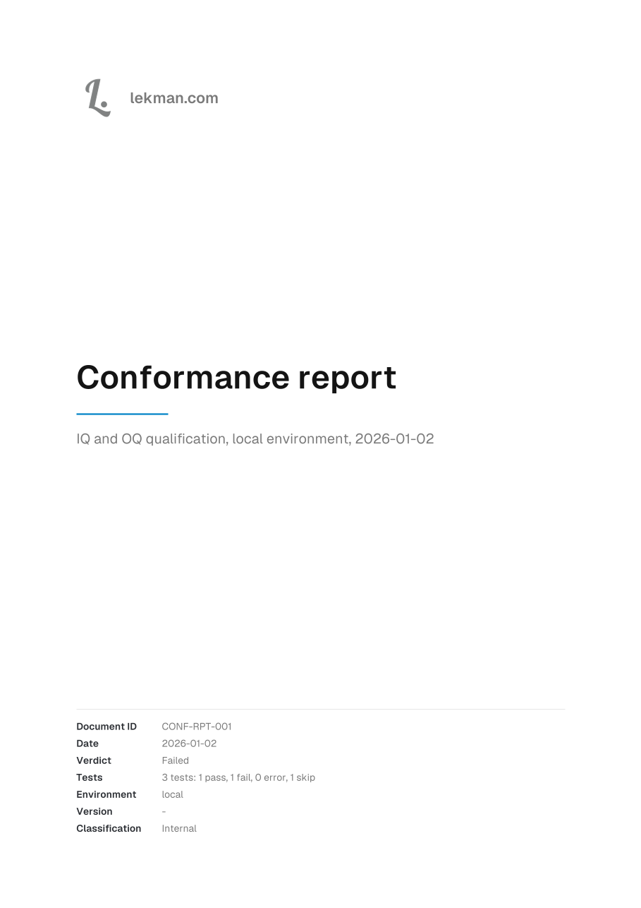
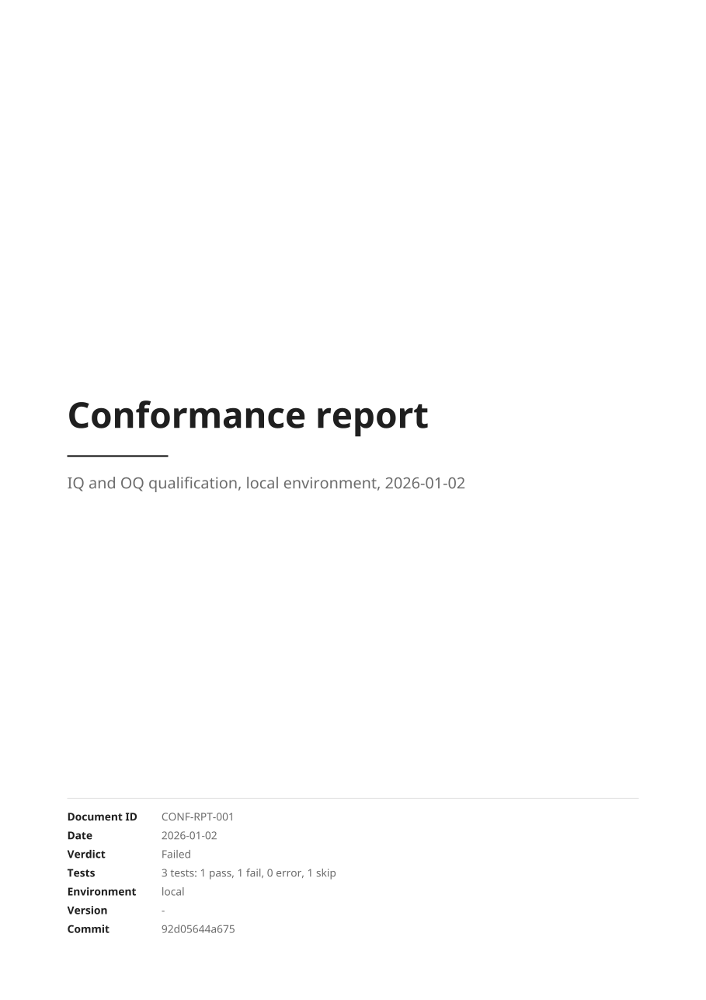
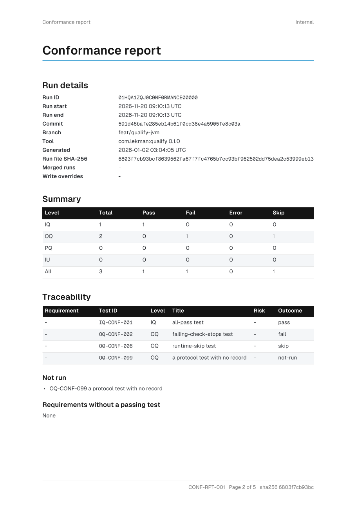
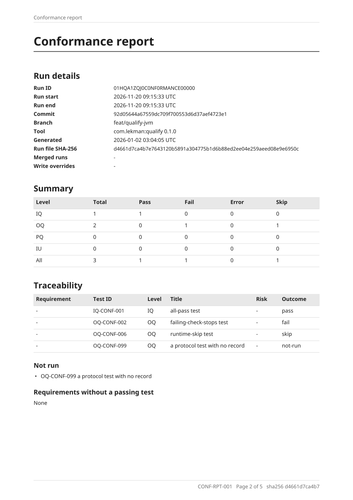
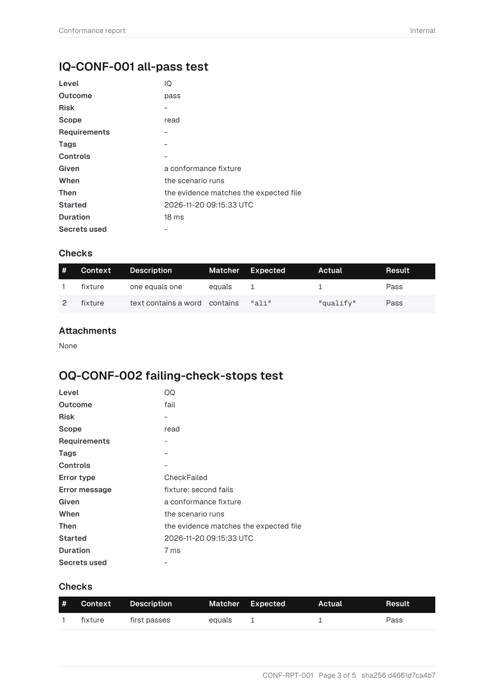
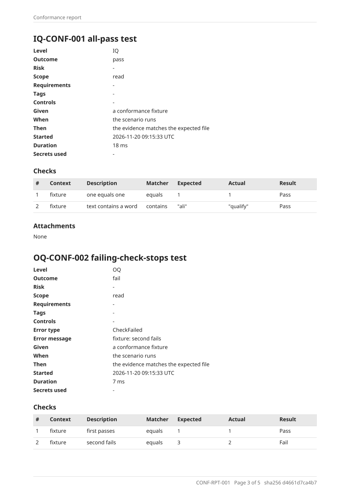

# com.lekman:qualify

> Qualification tests (IQ, OQ, PQ, intended use) for JUnit 5, from Java or
> Kotlin, that leave redacted JSON evidence and a PDF report a reviewer can
> sign.

This is the Java implementation of the
[qualify specification](../../spec/qualify/README.md). It writes the same
evidence files as the TypeScript reference,
[@lekman/qualify](../qualify-ts/README.md), and passes the same conformance
scenarios. Version 0.2.0 is on Maven Central.

## Why

A passing test run says that the tests passed. It does not say what each test
claimed, what it checked, which requirement it covers, or where it ran, and it
cannot be read six months later without the code. A qualification test here is
an ordinary JUnit test with an ID, a narrative (given, when, then) and recorded
checks. When it runs, the JVM that ran it writes one JSON record, with secrets
already removed. `qualify merge` builds one run file from the records, and
`qualify report` draws it as a PDF.

JUnit still runs the tests. There is no wrapper command: select tests with
Gradle's or Maven's own filters.

## Install

Gradle (Kotlin DSL):

```kotlin
dependencies {
    testImplementation("com.lekman:qualify:0.2.0")
}

tasks.test {
    useJUnitPlatform()
}
```

Maven:

```xml
<dependency>
  <groupId>com.lekman</groupId>
  <artifactId>qualify</artifactId>
  <version>0.2.0</version>
  <scope>test</scope>
</dependency>
```

Java 17 or later and JUnit Jupiter 5.13 or later, including JUnit 6. The
library is Java, so a Java project does not pull in the Kotlin runtime.

## Kotlin

```kotlin
import com.lekman.qualify.OQ
import com.lekman.qualify.QualifyContext
import com.lekman.qualify.Risk
import com.lekman.qualify.Scope

class BankFileTest {
    @OQ(
        id = "OQ-EXPORT-003",
        title = "The bank file never changes an amount",
        given = "a day of payments in three currencies",
        `when` = "the export writes the bank file",
        then = "every amount in the file equals the amount in the ledger",
        requirements = ["EXPORT-003"],
        risk = Risk.HIGH,
        scope = Scope.READ,
        tags = ["export"],
    )
    fun bankFileKeepsAmounts(ctx: QualifyContext) {
        val file = exportBankFile(ledger)
        ctx.check("bank file", "EUR keeps two decimals").that(file.amount("EUR")).isEqualTo("100.50")
    }
}
```

`when` is a Kotlin keyword, so it needs backticks. Kotlin data classes are
recorded as objects of their properties.

## Java

```java
import com.lekman.qualify.OQ;
import com.lekman.qualify.QualifyContext;
import com.lekman.qualify.Risk;
import com.lekman.qualify.Scope;

class BankFileTest {
  @OQ(id = "OQ-EXPORT-003", title = "The bank file never changes an amount",
      given = "a day of payments in three currencies",
      when = "the export writes the bank file",
      then = "every amount in the file equals the amount in the ledger",
      requirements = {"EXPORT-003"}, risk = Risk.HIGH, scope = Scope.READ, tags = {"export"})
  void bankFileKeepsAmounts(QualifyContext ctx) {
    var file = exportBankFile(ledger);
    ctx.check("bank file", "EUR keeps two decimals").that(file.amount("EUR")).isEqualTo("100.50");
  }
}
```

`@IQ`, `@OQ`, `@PQ` and `@IU` are JUnit tests: each is meta-annotated with
`@Test`, `@Tag` for its level and `@ExtendWith(QualifyExtension.class)`. `@IQ`
and `@IU` have no `scope` attribute, because their scope is always `read` and
`read-write`; `@OQ` and `@PQ` must declare one.

## The Context

| Method                                    | Records                                                                   |
| ----------------------------------------- | ------------------------------------------------------------------------- |
| `check(context, description).that(value)` | a hard check: a failure throws `CheckFailed` and ends the test            |
| `check(...).soft().that(value)`           | a soft check: the test goes on and fails at the end                       |
| `delegate(context, description, work)`    | one check around work that has its own assertions                         |
| `delegateValue(...)`                      | the same, returning the work's result                                     |
| `attach(filename, body, contentType)`     | an inline attachment: a `String`, a `byte[]`, or any value for JSON       |
| `secret(name)`                            | reads `QUALIFY_SECRET_<NAME>` and redacts its value everywhere            |
| `redact(value)`                           | redacts a value of 6 or more characters                                   |
| `skip(reason)`                            | a skip: JUnit shows the test as aborted                                   |
| `runContext()`, `runContext(extra)`       | `run-context.json`: the run's source, actor and target                    |
| `getId()`, `getLevel()`, `getEnvironment` | the test's identity; Kotlin reads them as `ctx.id`, `ctx.level` and so on |

Matchers: `isEqualTo`, `isNotEqualTo`, `contains`, `matches`, `isTrue`,
`isFalse`, `isNull`, `isNotNull`, `hasLength`, `isAtLeast`, `isAtMost` and
`isOneOf`. The evidence records the shared names of section 3.2 of the
specification (`equals`, `atLeast` and so on).

## Selecting Tests

- **By level:** `useJUnitPlatform { includeTags("OQ") }` in Gradle, or
  `-Dgroups=OQ` in Maven.
- **By tag:** add JUnit's own `@Tag("export")` to the method or its class.
  qualify records it in `tags` beside the values of the `tags` attribute. A
  value only in the `tags` attribute is recorded but cannot be selected,
  because JUnit reads tags from `@Tag` annotations alone.
- **By ID:** with the method name filter, for example
  `./gradlew test --tests '*BankFileTest.bankFileKeepsAmounts'`. A deselected
  test writes no record; a protocol lists it as not run.

## Settings

Each setting is an environment variable and a JUnit configuration parameter
(`junit-platform.properties`, a system property, or
`systemProperty(...)` in Gradle). The environment variable wins.

| Variable                   | Configuration parameter   | Default                                                   |
| -------------------------- | ------------------------- | --------------------------------------------------------- |
| `QUALIFY_EVIDENCE_DIR`     | `qualify.evidenceDir`     | `qualification/evidence`                                  |
| `QUALIFY_RUN_ID`           | `qualify.runId`           | one per launcher session                                  |
| `QUALIFY_ENVIRONMENT`      | `qualify.environment`     | `local`                                                   |
| `QUALIFY_PRODUCTION`       | `qualify.production`      | `production,prod`                                         |
| `QUALIFY_ALLOW_WRITE`      | `qualify.allowWrite`      | none                                                      |
| `QUALIFY_NO_OVERRIDES`     | `qualify.noOverrides`     | off                                                       |
| `QUALIFY_ATTACHMENT_LIMIT` | `qualify.attachmentLimit` | 1048576 bytes                                             |
| none                       | `qualify.configuration`   | none                                                      |
| none                       | `qualify.sourceRoots`     | none; `src/*/java` and `src/*/kotlin` are always searched |

`qualify.configuration` names a class implementing `QualifyConfiguration`, with
a public no-argument constructor: your own environment resolver, secret source
and "not applicable" rules. `qualify.sourceRoots` adds source folders, relative
to the working directory, for the `path:line` sites in the evidence.

The run ID is shared by every test of one JUnit launcher session. Gradle starts
one launcher session per test JVM, so with `maxParallelForks` above 1 or
`forkEvery` set, each fork has its own run ID. Set `QUALIFY_RUN_ID` (any ULID)
in the job, which every test JVM inherits, or merge the forks' runs with
`merge --allow-runs`.

## The CLI

`qualify-0.2.0-cli.jar` holds `merge`, `validate` and `report` with the flags
and exit codes of section 8 of the specification. Maven Central has the
library only, so build the CLI jar from this folder with `./gradlew cliJar`;
it is written to `build/libs/`.

```bash
java -jar qualify-0.2.0-cli.jar merge --evidence-dir qualification/evidence
java -jar qualify-0.2.0-cli.jar validate qualification/evidence/test-evidence.json
java -jar qualify-0.2.0-cli.jar report qualification/evidence/test-evidence.json \
  --pdf report.pdf --protocol protocol.yaml --theme plain
```

`trace`, the Markdown and JSON trace matrix, is in the TypeScript package:
`npx @lekman/qualify trace ...`. The Java CLI prints that pointer and exits 64.

`import junit`, which turns JUnit XML and LCOV coverage from unit tests into a
run file, is in the TypeScript package only for now:
`npx @lekman/qualify import junit junit.xml --coverage lcov.info`. This
package's `validate` accepts the run file it writes, and `report` draws its
cover, with the test counts, and its run details. The summary table counts no
test cases, and the coverage and the test cases are left out; draw the full
report with `npx @lekman/qualify report`.

## The Report

`report` draws a run file as a PDF with Apache PDFBox: a cover, the run
details, the summary and the trace table, one section per test with PNG and
JPEG attachments drawn as images, and a signature block. A theme decides the logo, fonts, colours and texts; both
themes of [spec/qualify/report/README.md](../../spec/qualify/report/README.md)
ship in the jar, byte for byte, and `--theme path/to/theme.json` takes your
own. The pages below are from the conformance run,
[sample-report-lekman.pdf](docs/sample-report-lekman.pdf) and
[sample-report-plain.pdf](docs/sample-report-plain.pdf), rendered with PDFBox's
own renderer.

| `lekman` theme (default)                      | `plain` theme                                |
| --------------------------------------------- | -------------------------------------------- |
|        |        |
|  |  |
|        |        |

### Screenshots in the Report

An attachment with content type `image/png` or `image/jpeg` is drawn below the
test's attachments table, in the order attached, with a caption of its file
name, size and the start of its SHA-256. It is scaled down to the text width
and half the page's text height, never up, and kept on one page with its
caption. An image that cannot be read is listed with a note instead; the report
still succeeds.

```java
// After a Playwright for Java screenshot.
byte[] png = page.screenshot(new Page.ScreenshotOptions().setType(ScreenshotType.PNG));
ctx.attach("IU-DASH-001-1.png", png, "image/png");
```

A viewport screenshot fits the 1 MiB attachment limit
(`QUALIFY_ATTACHMENT_LIMIT`) with room to spare. Measured on a dashboard page:

| Viewport                 | PNG     | JPEG, quality 80 |
| ------------------------ | ------- | ---------------- |
| 1280 x 720               | 138 KiB | 101 KiB          |
| 1920 x 1080              | 199 KiB | 166 KiB          |
| 1440 x 900 at 2x density | 339 KiB | 285 KiB          |

- Use PNG of the viewport at device scale 1. Text stays sharp, and for a flat
  user interface PNG is about as small as JPEG. On A4 the report draws a
  1280-pixel-wide screenshot 160 to 170 mm wide, near 200 pixels per inch, so
  a 2x screenshot adds bytes and no detail.
- Use JPEG at quality 80 for photographs, maps or video frames, or for a
  full-page screenshot that would pass the limit as PNG.

## What It Costs

- **Dependencies at run time,** besides JUnit: Jackson 3.2.4 (databind, core,
  YAML) with snakeyaml-engine 3.0.1, json-schema-validator 3.0.9 with itu
  1.17.0 and slf4j-api 2.0.20, Apache PDFBox 3.0.8 with fontbox, pdfbox-io and
  commons-logging 1.4.0, and JSpecify 1.0.0 for the nullness annotations
  Kotlin reads. About 7.5 MB of jars. The library jar is 1 MB, most of it the
  two themes' fonts. Jackson 3 lives in `tools.jackson`, so it sits beside a
  project's Jackson 2 without a conflict.
- **The CLI jar** is 9 MB, everything included. It needs only a Java 17 runtime.
- **Each test** reads its class file once, to find the first line of its
  method, and writes two small files. A test JVM runs `git` three times at the
  start, for the commit, branch and state.
- **Build plugins** (building this package, not using it): Gradle 9.9.2 with
  the Kotlin plugin 2.4.21, Shadow 9.6.1 for the CLI jar, Spotless 8.11.0 with
  google-java-format 1.32.0 and ktlint 1.7.1, Error Prone 2.52.0 through its
  Gradle plugin 5.2.0 with NullAway 0.14.3, detekt 1.23.8, JaCoCo 0.8.14, and
  the foojay toolchain resolver 1.0.0. Error Prone and google-java-format run
  only on JDK 21 or later, so the build compiles on JDK 21 for Java 17 and runs
  the tests on Java 17.

## Limits

- The declaration site is the first line of the method's body, read from the
  class file's line numbers, because Java cannot report the line of an
  annotation. Classes compiled without line numbers record line 0.
- A `path:line` site is found by looking for the class's source file under the
  source roots. A file that is not found keeps its package path, such as
  `com/acme/ExportTest.java:12`.
- `timeoutMs` is not an attribute: use JUnit's own `@Timeout` beside the
  annotation.
- Values are recorded by section 7.1 of the specification. Records, maps,
  collections, arrays and objects with public getters become JSON. A type from
  the JDK or the Kotlin standard library that the specification does not name
  becomes `"[unserialisable: <type>]"`; `isEqualTo` then falls back to the
  objects' own `equals`. A `float` is recorded as the decimal it was written
  as (`0.1f` is `0.1`). A non-string map key is recorded as its normalised
  string, or its compact JSON.
- A `delegate` check names the method a lambda or method reference calls, such
  as `com.acme.ExportTest.sharedHelper`; a lambda written inline is named
  `lambda$...` by the compiler.
- A failure whose message holds a registered secret is replaced, for JUnit's
  report, by one with the same stack trace and a redacted message, and without
  its cause.
- Fonts are embedded as subsets with PDFBox's TrueType support; an OpenType
  font with CFF outlines is not supported.

## Development

```bash
./gradlew build        # Spotless, Error Prone with NullAway, detekt, tests, coverage gate, CLI jar
./gradlew conformance  # every scenario, through the JUnit Platform launcher
./gradlew conformance -Ponly=crash,report
./gradlew spotlessApply
```

`mise.toml` pins Temurin 17 for the Gradle launcher and the tests. The
Gradle daemon runs on JDK 21 (`gradle/gradle-daemon-jvm.properties`), which
Gradle downloads when none is installed. The trace scenarios call the
TypeScript CLI, so run `bun install && bun run build` at the repository root
first. Coverage is checked at 80% of lines and instructions and 60% of
methods.

The conformance harness runs each scenario's test classes in a fresh JVM with a
clean `QUALIFY_*` environment, merges with the CLI jar, masks the run file and
compares it with `spec/qualify/conformance/expected/` byte for byte. It never
writes an expected file.
