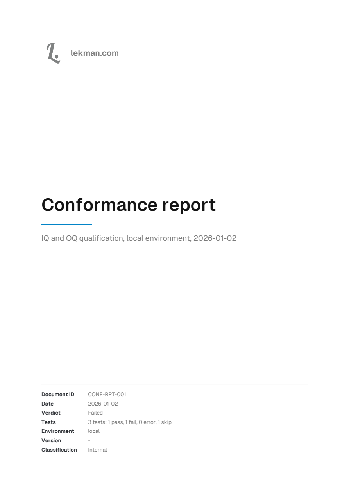
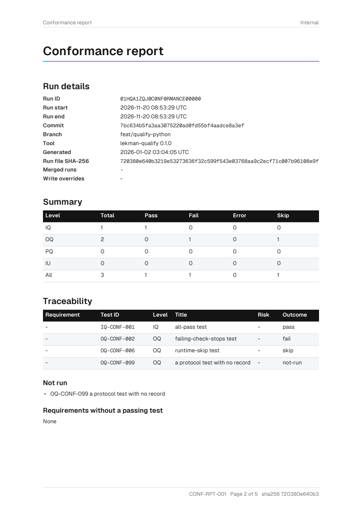
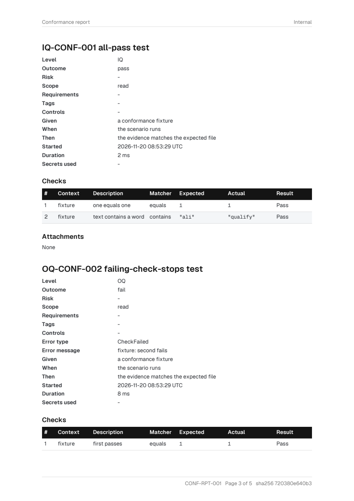
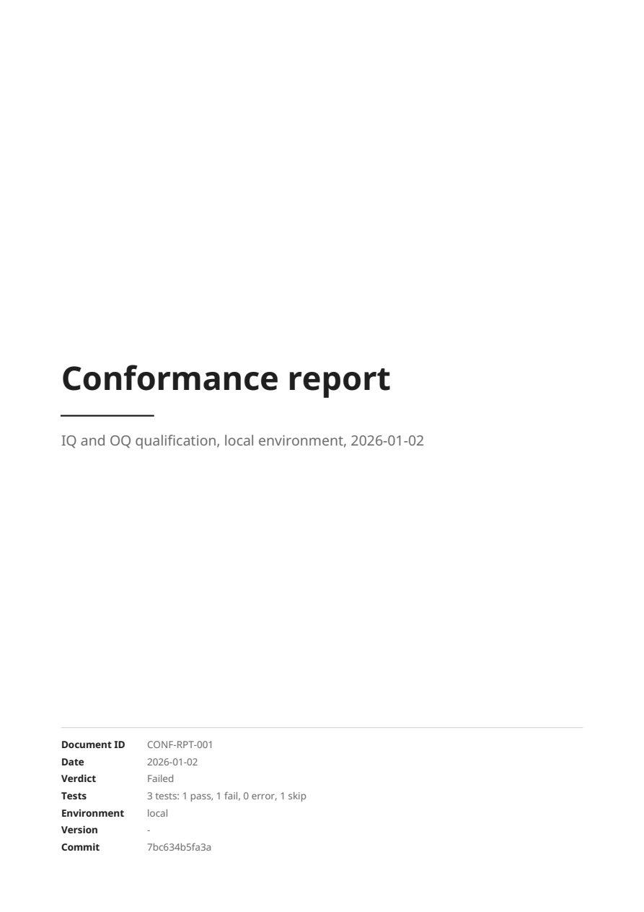
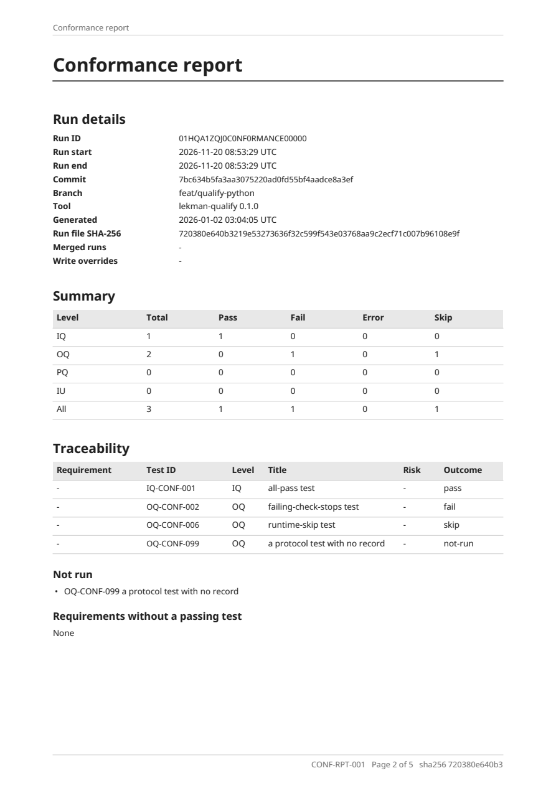
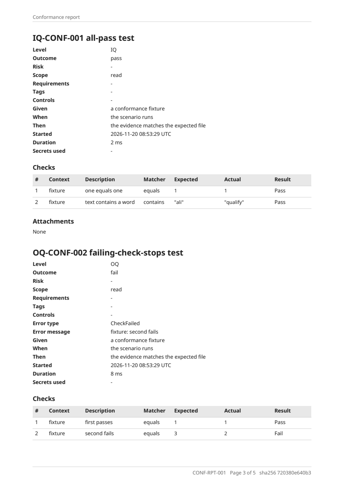

# lekman-qualify

> Qualification tests (IQ, OQ, PQ, intended use) for pytest that leave redacted
> JSON evidence and a PDF report a reviewer can read without the code.

This is the Python implementation of the
[qualify specification](../../spec/qualify/README.md), as a pytest plugin. It
writes the same evidence files as the TypeScript reference
[@lekman/qualify](../qualify-ts/README.md) and passes the same conformance
scenarios. It is not published yet.

## Why

A passing test run says that the tests passed. It does not say what each test
claimed, what it checked, which requirement it covers, or where it ran, and it
cannot be read six months later without the code. A qualification test here is
an ordinary pytest test with an ID, a narrative (given, when, then) and
recorded checks. When it runs, the process that ran it writes one JSON record,
with secrets already removed. `qualify merge` builds one run file from the
records, and `qualify report` renders it as a PDF to read, sign and file.

pytest still runs the tests. There is no wrapper command: select tests with
pytest's own `-k` and `-m`.

## Install

```bash
pip install lekman-qualify
uv add --dev lekman-qualify
```

Python 3.10 or later and pytest 8.3 or later. The plugin registers itself
through the `pytest11` entry point; there is nothing to add to `conftest.py`.

## A Test

```python
import qualify


@qualify.oq(
    "OQ-EXPORT-003",
    "The bank file never changes an amount",
    given="a day of payments in three currencies",
    when="the export writes the bank file",
    then="every amount in the file equals the amount in the ledger",
    requirements=["EXPORT-003"],
    risk="high",
    scope="read",
    tags=["export"],
)
def test_bank_file_keeps_amounts(ctx: qualify.Context, ledger) -> None:
    file = export_bank_file(ledger)  # ledger is an ordinary fixture
    ctx.check("bank file", "EUR keeps two decimals").that(file.amount("EUR")).equals("100.50")
```

`qualify.iq`, `qualify.oq`, `qualify.pq` and `qualify.iu` declare the level.
`scope` is required for OQ and PQ (`read` or `read-write`); IQ is always
`read` and IU always `read-write`. Further clauses after `then` go in `and_`,
because `and` is a Python keyword. The function must still be named `test_...`
for pytest to collect it; the plugin warns when a declared function is not.

```bash
pytest -k OQ-EXPORT-003          # one test, by ID
pytest -m oq                     # every OQ test
pytest -m "oq and not slow"      # by level and tag
pytest --qualify-merge           # also build the run file at the end
```

A declaration error, such as an OQ test with no `scope` or an ID that does
not match its level, fails collection with one error per test and writes no
evidence. Parametrised qualification tests are refused in the same way,
because one ID must map to one record; declare each case with its own ID.

## The Context

| Call                                                | Does                                                                 |
| --------------------------------------------------- | -------------------------------------------------------------------- |
| `ctx.check(context, description).that(v).equals(x)` | A hard check: records, then raises `CheckFailed` if it fails         |
| `ctx.check(...).soft().that(v)...`                  | A soft check: records and continues; the test fails at the end       |
| `ctx.delegate(context, description, fn)`            | Runs `fn`, which has its own assertions, and records it as one check |
| `ctx.attach(filename, body, content_type)`          | An inline attachment; `application/json` also takes a value          |
| `ctx.secret(name)`                                  | Reads `QUALIFY_SECRET_<NAME>`, registers it, returns a `Secret`      |
| `ctx.redact(value)`                                 | Registers a value for redaction                                      |
| `ctx.skip(reason)`                                  | Skips the test at runtime (`pytest.skip`), with the reason recorded  |
| `ctx.run_context(extra)`                            | Attaches `run-context.json` with the run's source, actor and target  |
| `ctx.id`, `ctx.level`, `ctx.environment`            | Identity, and where the test runs                                    |

Matchers: `equals`, `not_equals`, `contains`, `matches`, `is_true`,
`is_false`, `is_null`, `is_not_null`, `has_length`, `at_least`, `at_most`,
`one_of`. The evidence records the shared camel-case names (`notEquals`,
`isTrue`). Values are compared after the normalisation in section 7.1 of the
specification, so `NaN` equals `NaN`, `1` equals `1.0`, and key order does not
matter.

`qualify.Secret` is a `str` subclass whose `repr()` hides the value and which
registers the value for redaction when it is created. Use it for any secret
your own fixtures read:

```python
@pytest.fixture
def api_token() -> qualify.Secret:
    return qualify.Secret(vault.read("api-token"))
```

### Outcomes

The outcome comes from a `pytest_runtest_makereport` hook wrapper that reads
the exception of the phase that ended the test.

| The test ends with                                                | Outcome                               |
| ----------------------------------------------------------------- | ------------------------------------- |
| Nothing, and every check passed                                   | `pass`                                |
| A failed check, an `AssertionError`, or `pytest.fail()`           | `fail`                                |
| Any other exception, also from a fixture during setup             | `error`, with the type and message    |
| `ctx.skip()`, `pytest.skip()`, a skip marker, or `pytest.xfail()` | `skip`, with the reason               |
| A write-protection or "not applicable" rule                       | `skip`, before any fixture runs       |
| The process dies (a crash, a killed worker)                       | `error`, `DidNotFinish`, from `merge` |

A hard check that fails raises `CheckFailed`. If the body catches it, the test
still fails at the end, because a record says `pass` only when every check
passed. An `xfail` marker does not change the record: a test that fails is
recorded as failing, whatever pytest reports. A teardown error after the body
does not change the record either.

## Settings

| Variable                   | pytest ini option          | Default                  | Meaning                                                      |
| -------------------------- | -------------------------- | ------------------------ | ------------------------------------------------------------ |
| `QUALIFY_ENVIRONMENT`      | `qualify_environment`      | `local`                  | The environment name                                         |
| `QUALIFY_PRODUCTION`       | `qualify_production`       | `production,prod`        | Environments where `read-write` tests are skipped            |
| `QUALIFY_ALLOW_WRITE`      | `qualify_allow_write`      | none                     | `ID=reason;ID=reason`: tests allowed to write in production  |
| `QUALIFY_NO_OVERRIDES`     | `qualify_no_overrides`     | off                      | `1` refuses every override and stops the run at start        |
| `QUALIFY_EVIDENCE_DIR`     | `qualify_evidence_dir`     | `qualification/evidence` | Where records and the run file go                            |
| `QUALIFY_ATTACHMENT_LIMIT` | `qualify_attachment_limit` | `1048576`                | Bytes per attachment; a larger one ends the test as an error |
| `QUALIFY_RUN_ID`           |                            | created per run          | Share one run across jobs, machines or languages             |
| `QUALIFY_TARGET_<NAME>`    |                            | none                     | Facts about the target, recorded as `run.target.<name>`      |

The environment variable wins over the ini option. `QUALIFY_EVIDENCE_DIR` is
relative to the working directory; `qualify_evidence_dir` is relative to
pytest's rootdir. A setting that cannot be used stops the run before any test
starts, with a usage error.

Code can give the same settings, and three that only code can give, in
`conftest.py`. The variables and ini options still win.

```python
# conftest.py
import qualify

qualify.configure(
    resolve_environment=lambda: deploy_target(),  # if it raises: production
    secret_source=lambda name: vault.read(name),  # behind ctx.secret
    not_applicable=[qualify.NotApplicable("no GPU in CI", tags=["gpu"], environments=["ci"])],
)
```

## pytest-xdist

Each worker writes its own records. The controller creates one run ID (or
takes `QUALIFY_RUN_ID`) and hands it to every worker, so all records of one
`pytest -n 4` run share it. With `--qualify-merge`, the controller merges once
the workers have finished. The conformance suite runs scenarios 1, 2 and 13 on
two workers, twice, and checks both run files are identical.

## The CLI

```text
qualify merge    [--evidence-dir DIR] [--allow-runs ID,ID] [--out FILE]
qualify validate FILE...
qualify report   RUNFILE --pdf FILE [--protocol protocol.yaml] [--map trace.yaml]
                 [--theme NAME|PATH] [--title TEXT] [--subtitle TEXT]
                 [--document-id TEXT] [--classification TEXT]
                 [--signatures ROLE;ROLE;...] [--no-signatures]
```

`python -m qualify` is the same command. Exit codes are those of section 8 of
the specification: 0 pass, 1 a test failed or errored, 2 invalid input (no
file written), 3 incomplete, 64 usage error. `merge` writes
`test-evidence.json` and its `.sha256` sidecar. `report` exits 0 whenever it
writes the PDF, because a failed run needs its report too.

`qualify trace` is in the TypeScript package only. The Python command prints
where to find it and exits 64:

```bash
npx @lekman/qualify trace qualification/evidence/test-evidence.json \
  --protocol protocol.yaml --md trace.md --json trace.json
```

## The PDF Report

```bash
qualify report qualification/evidence/test-evidence.json --pdf report.pdf \
  --protocol protocol.yaml --theme plain --document-id PROJ-123-OQ
```

`report` renders a run file as a PDF a reviewer can read, sign and file
without the code: a cover page with the verdict and the counts, the run
details with the run file's SHA-256, the summary and trace table, one section
per test with its narrative, checks and attachments, and blank signature
lines. The layout is section 9 of the specification; how it looks comes from a
theme. Two themes ship, byte for byte the ones in
[spec/qualify/report/](../../spec/qualify/report/README.md): `lekman`, the
default, and `plain`, with no logo and Noto Sans. `--theme` takes a name or the
path of your own `theme.json`, and `QUALIFY_REPORT_THEME` does the same; the
flag wins. Set `QUALIFY_REPORT_TIME` to an ISO 8601 UTC instant to reproduce a
report with a fixed generation time.

The first three pages of [a sample report](docs/sample-report-lekman.pdf) with
the default theme, rendered from the conformance run of scenarios 1, 2 and 6:







The same run with `--theme plain` ([PDF](docs/sample-report-plain.pdf)):







## What It Costs

- **Three runtime dependencies besides pytest, about 31 MB installed.** A
  correct draft 2020-12 validator and a PDF writer with font subsetting are not
  worth writing again.

  | Package              | Installed | For                                                                                   |
  | -------------------- | --------- | ------------------------------------------------------------------------------------- |
  | `fpdf2` 2.8 or later | 28 MB     | Writing the PDF. Most of it is `fontTools` (14 MB) and `Pillow` (12 MB), both needed. |
  | `jsonschema` 4.18    | 2 MB      | Schema validation, with `attrs`, `referencing` and `rpds-py` (a compiled extension).  |
  | `PyYAML` 6           | 0.6 MB    | Reading `protocol.yaml` and `trace.yaml`, as YAML 1.2 reads them.                     |

  The plugin imports none of the report's dependencies; only `qualify report`
  does. `fpdf2` is under the LGPL-3.0, used unmodified as a library.

- **Two bundled themes, 1.7 MB.** The wheel is about 900 KB, most of it the
  fonts: Geist for `lekman` and Noto Sans for `plain`, under the SIL Open Font
  License. A report embeds only the glyphs it uses, so a short one is about
  20 KB (`plain`) to 65 KB (`lekman`, with its logo). A character the theme's
  font cannot draw prints as `?`; the evidence keeps the exact text. The
  `lekman` logo and name are the author's marks and not under the MIT licence;
  use `plain`, or your own theme, for your reports.
- **The plugin loads in every pytest run** in an environment that has it
  installed. Without a qualification test it writes nothing and runs no git
  command. It still checks the `QUALIFY_*` settings when the session starts.
- **Sites come from the stack.** A check's site is the first frame outside
  qualify's own code, so a helper that wraps `ctx.check` records the helper's
  line.
- **Attachments are inline**, base64 in the JSON, 1 MiB each by default. A
  larger attachment ends the test as an error; it is never truncated.
- **Redaction is process-wide.** A value registered in one test is redacted in
  every later record of the same process, and in pytest's own failure output
  for those tests. Values shorter than 6 characters are refused with a
  `RedactionWarning`, because they would redact ordinary words.
- **`delegate` runs synchronous functions only.** For async code, await it in
  the test and check its result.
- **Python types with no JSON counterpart.** `Decimal`, `UUID` and paths are
  recorded as strings, an `Enum` as its value, a dataclass as a map of its
  fields, a naive `datetime` as UTC, and anything else as
  `[unserialisable: <type>]`.
- **`timeout_ms` needs pytest-timeout.** The declaration turns it into a
  `pytest.mark.timeout` marker; without that plugin, the marker does nothing.

## Layout and Contributing

```text
src/qualify/
  api.py          the iq, oq, pq and iu decorators
  plugin.py       the pytest hooks and the ctx fixture
  context.py      ctx, checks, matchers, Secret
  recorder.py     the started marker and the redacted record of one test
  declaration.py  sections 2.1 and 4: declarations and IDs
  settings.py     section 5: settings, write protection, not-applicable rules
  envelope.py     section 6.4: the run envelope, git, ULIDs
  evidence.py     section 6: file names and the atomic writer
  values.py       section 7.1: normalisation, and numbers as JavaScript prints them
  jsontext.py     section 6.3: how every evidence file is written
  redaction.py    section 7.2
  merge.py        section 6.5
  schema.py       validation against schemas/, copies of spec/qualify/*.schema.json
  cli.py          section 8: merge, validate and report
  trace.py        the trace rows the report shows, and protocol.yaml and trace.yaml
  theme.py        section 9.3: loading and checking themes, and their templates
  report/         section 9: content.py what it says, layout.py where, pdf.py drawn with fpdf2
  themes/         the bundled themes, copies of spec/qualify/report/themes/
tests/            unit tests, and the plugin through pytester
conformance/      one test file per scenario, run.py (the harness), and pdf_text.py
scripts/          render_pages.py: PDF pages to PNG with pypdfium2, for the images above
```

```bash
uv sync
uv run ruff format --check . && uv run ruff check .
uv run mypy                       # strict
uv run pytest --cov               # fails under 80 % line coverage
bun run build                     # at the repository root, for the trace scenarios
uv run python conformance/run.py  # every scenario, diffed against the expected files
```

The harness runs each scenario's test file through pytest in a fresh evidence
directory, with every other `QUALIFY_*` and `PYTEST_*` variable removed, then
runs this package's `qualify merge`, masks the run file and compares it byte
for byte with `spec/qualify/conformance/expected/`. Scenarios 12, 19 and 20 run
`node packages/qualify-ts/dist/cli.js trace` on the Python run file. Scenarios 21
and 22 render reports, extract their text with `pypdf`, and find every line of
the outline files in order. The harness never writes an expected file; they
belong to the TypeScript reference.

Text extraction cannot see a glyph drawn wrong, so look at the pages too.
`uv run python conformance/run.py --only report --sample docs` keeps the two
sample PDFs, and `uv run python scripts/render_pages.py
docs/sample-report-lekman.pdf docs/report-lekman` writes the page images.

## Related

- [spec/qualify/README.md](../../spec/qualify/README.md): the contract every
  implementation follows.
- [practices/qualification-tests/README.md](../../practices/qualification-tests/README.md):
  the problem, the pattern, and when not to use it.
