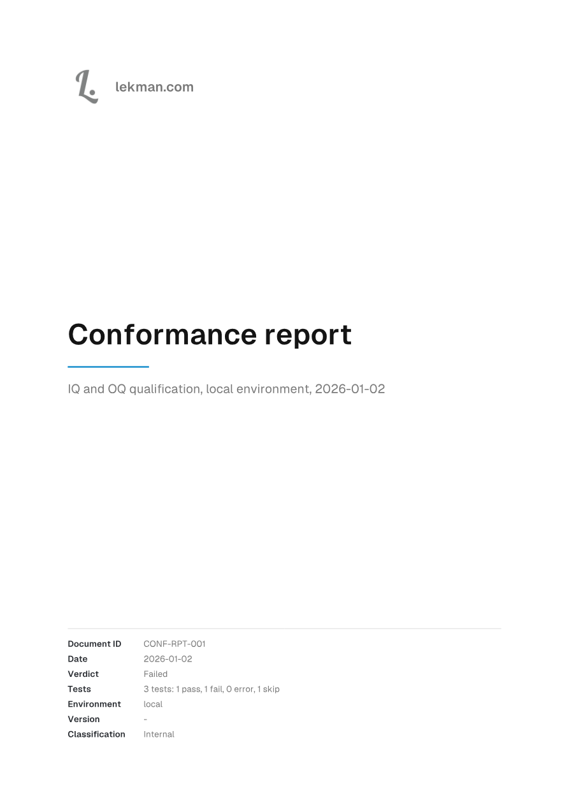
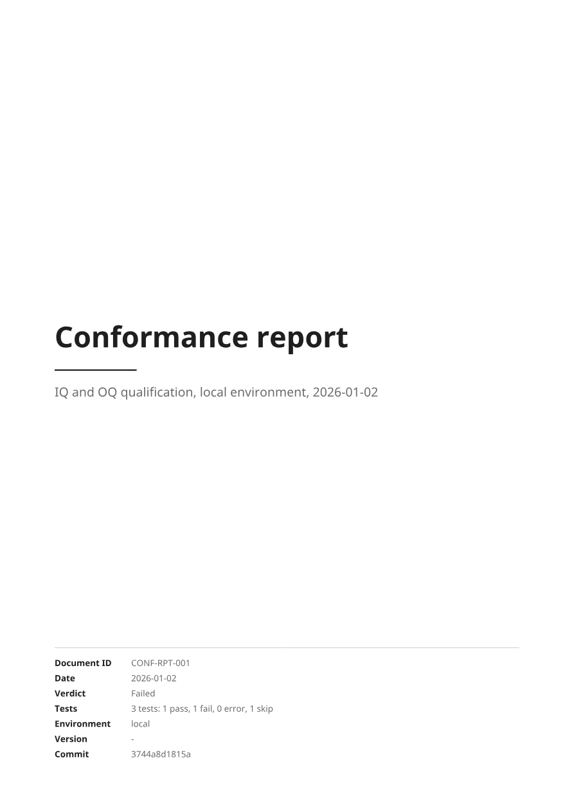
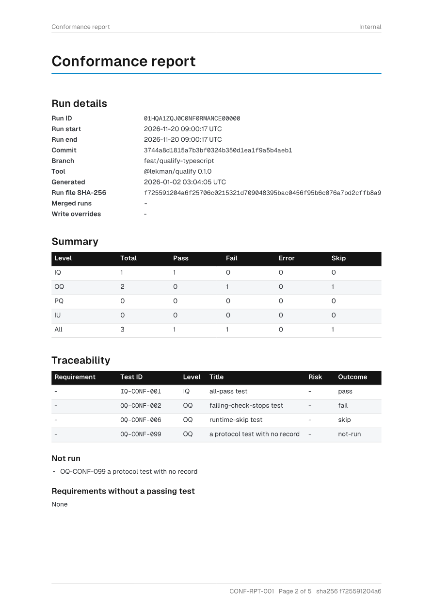
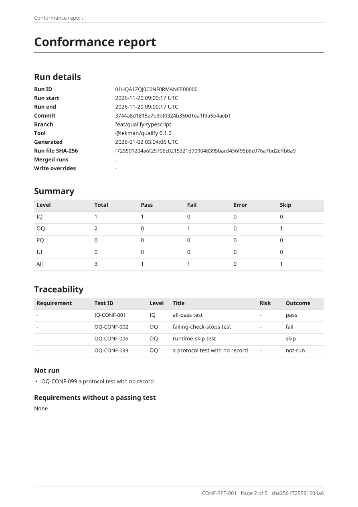
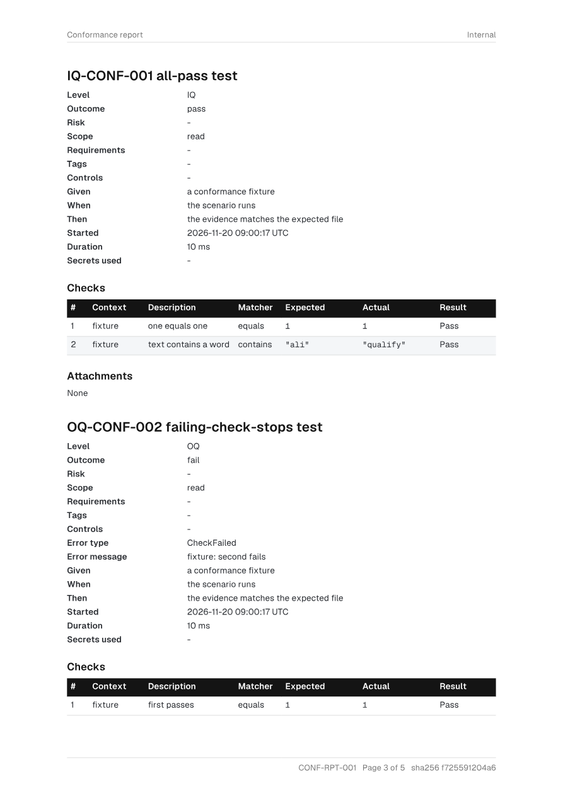
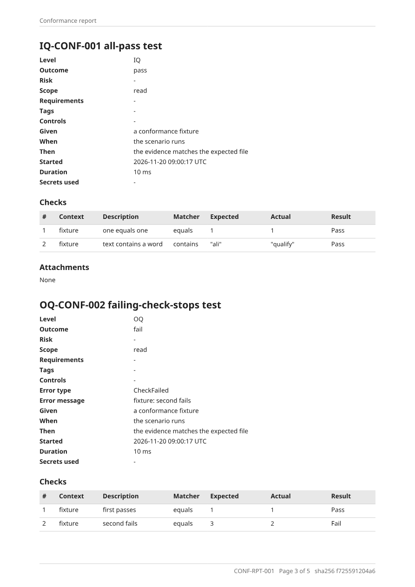

# @lekman/qualify

> Qualification tests (IQ, OQ, PQ, intended use) for vitest, `node:test`, bun
> and cucumber-js that leave redacted JSON evidence and a trace matrix from
> requirements to results.

This is the TypeScript reference implementation of the
[qualify specification](../../spec/qualify/README.md). It is not published
yet; the Python and Java packages that follow the same specification are in
progress.

## Why

A passing test run says that the tests passed. It does not say what each test
claimed, what it checked, which requirement it covers, or where it ran, and it
cannot be read six months later without the code. A qualification test here is
an ordinary test with an ID, a narrative (given, when, then) and recorded
checks. When it runs, the process that ran it writes one JSON record, with
secrets already removed. `qualify merge` builds one run file from the records,
and `qualify trace` links each result to its requirements.

Your runner still runs the tests. There is no wrapper command: select tests
with the runner's own filters (`vitest -t OQ-EXPORT-003`).

## Install

```bash
npm install --save-dev @lekman/qualify
```

Node 20 or later. vitest and `@cucumber/cucumber` are optional peer
dependencies; `node:test` and bun need nothing else.

## vitest

```ts
// vitest.config.ts
import { defineConfig } from "vitest/config";

export default defineConfig({
  test: { globalSetup: ["@lekman/qualify/vitest/setup"] },
});
```

```ts
// export.qualify.test.ts
import { oq } from "@lekman/qualify/vitest";

oq(
  "OQ-EXPORT-003",
  "The bank file never changes an amount",
  {
    given: "a day of payments in three currencies",
    when: "the export writes the bank file",
    then: "every amount in the file equals the amount in the ledger",
    requirements: ["EXPORT-003"],
    risk: "high",
    scope: "read",
  },
  async (ctx) => {
    const file = await exportBankFile(ledger);
    ctx
      .check("bank file", "EUR keeps two decimals")
      .that(file.amount("EUR"))
      .equals("100.50");
  },
);
```

The global setup creates one run ID for every worker (or takes
`QUALIFY_RUN_ID`) and checks the settings, so a bad setting fails the run
before any test starts. The body's second argument is vitest's own test
context.

## node:test

```ts
// export.test.ts
import { oq } from "@lekman/qualify/node";

oq(
  "OQ-EXPORT-003",
  "The bank file never changes an amount",
  {
    given: "a day of payments in three currencies",
    when: "the export writes the bank file",
    then: "every amount in the file equals the amount in the ledger",
    scope: "read",
  },
  async (ctx, t) => {
    const file = await exportBankFile(ledger);
    ctx
      .check("bank file", "EUR keeps two decimals")
      .that(file.amount("EUR"))
      .equals("100.50");
  },
);
```

`node --test` runs each file in its own process, so the files share one run ID
through `QUALIFY_RUN_ID`. Set it in the job, or let the global setup set it
(Node 24 or later). `--test-global-setup` takes a file path, so re-export the
setup from a file in your project:

```ts
// qualify.setup.mjs
export { globalSetup } from "@lekman/qualify/node/setup";
```

```bash
node --test --test-global-setup=qualify.setup.mjs
```

On Node 22, run the files in one process instead
(`node --test --experimental-test-isolation=none`), and that process creates
the ID. Loading the setup with `--import` does not work: Node runs it in each
file's process, never in the main one. Without any of these, a test fails and
says what to add.

## bun

```ts
// export.test.ts
import { oq } from "@lekman/qualify/bun";

oq(
  "OQ-EXPORT-003",
  "The bank file never changes an amount",
  {
    given: "a day of payments in three currencies",
    when: "the export writes the bank file",
    then: "every amount in the file equals the amount in the ledger",
    scope: "read",
  },
  async (ctx) => {
    const file = await exportBankFile(ledger);
    ctx
      .check("bank file", "EUR keeps two decimals")
      .that(file.amount("EUR"))
      .equals("100.50");
  },
);
```

`bun test` runs every file in one process, which creates the run ID when
`QUALIFY_RUN_ID` is not set.

## cucumber-js

The Gherkin is the narrative. A scenario's name is `<ID> <title>`, its steps
are given, when and then, and its tags carry the rest of the declaration.

```gherkin
# features/export.feature
@export
Feature: Bank file export

  @REQ-EXPORT-003 @risk-high @scope-read
  Scenario: OQ-EXPORT-003 The bank file never changes an amount
    Given a day of payments in three currencies
    When the export writes the bank file
    Then every amount in the file equals the amount in the ledger
    And the file names the ledger it came from
```

```ts
// features/support/qualify.ts: load it before the other support files
import { install } from "@lekman/qualify/cucumber";

install();
```

```ts
// features/steps/export.steps.ts
import { Then } from "@cucumber/cucumber";
import { ctx } from "@lekman/qualify/cucumber";

Then(
  "every amount in the file equals the amount in the ledger",
  function (this: ExportWorld) {
    ctx(this)
      .check("bank file", "EUR keeps two decimals")
      .that(this.file.amount("EUR"))
      .equals("100.50");
  },
);
```

`ctx(this)` returns the same context as the other adapters, for the scenario
running in that world, so a step must be a `function`, not an arrow function.

| Gherkin                            | Becomes                                                                                         |
| ---------------------------------- | ----------------------------------------------------------------------------------------------- |
| `Scenario: <ID> <title>`           | The ID and title. The level is the ID's prefix, so `OQ-EXPORT-003` is an OQ test.               |
| Given steps                        | `given`, joined with `and` when there are several. Background steps come first.                 |
| When steps                         | `when`, joined the same way.                                                                    |
| The first Then step                | `then`                                                                                          |
| Every later step                   | One `and` clause each. A later Given or When step keeps its keyword: `When it is undone`.       |
| `@REQ-<ID>`                        | The requirement `REQ-<ID>`, one tag per requirement.                                            |
| `@risk-high`, `-medium`, `-low`    | `risk`                                                                                          |
| `@scope-read`, `@scope-read-write` | `scope`: required for OQ and PQ, refused for IQ and IU, as in section 2.1 of the specification. |
| `@controls-<ID>`                   | `controls`: the ID of the negative test this scenario is the control for.                       |
| Any other tag                      | A tag, without the `@`. Tags of the feature and rule count too.                                 |

A scenario that breaks a rule fails before its steps run, with a
`DeclarationError` that names every problem, and writes no evidence: a name
without an ID, steps that are not Given steps then When steps then a Then
step, a second risk, scope or control tag, or a field rule from the
specification. A Scenario Outline is refused, because one ID must map to one
record; write a Scenario for each ID. Step text is recorded without its data
table or doc string.

Each check's site is the line of the step that made it in the feature file,
and the test's site is the line of the scenario. Select scenarios with
cucumber's own filters: `--name "^OQ-EXPORT-003 "` or `--tags @export`.

```bash
npx cucumber-js                     # Node, with the support files in .js or .mjs
bun --bun cucumber-js               # Bun, which loads .ts support files itself
npx qualify merge
```

`install({ tags: "@qualification" })` makes only the scenarios that tag
expression selects qualification tests; the default is every scenario.
`install()` also:

- adds its Before hook to start the record and its After hook to write it.
  Load the support file that calls it first, so its Before hook runs before
  yours and its After hook after yours: a failure in your hooks then lands in
  the record.
- sets `QUALIFY_RUN_ID` in the main process when it is not set, before
  cucumber-js starts its `--parallel` workers, so every worker shares the run.
- sets cucumber's definition function wrapper. The wrapper keeps the first
  error for the record, redacts registered secrets in it before cucumber
  prints it, and turns `ctx.skip(reason)` into a skipped step. A project that
  sets a wrapper of its own calls ours from it:
  `setDefinitionFunctionWrapper((fn, options) => wrap(yours(fn, options)))`,
  with `wrap` from `@lekman/qualify/cucumber`. Without it, a skip still
  records `skip`, and cucumber shows the step as failed.

A failed soft check, or delegated work that fails after its step returned,
fails the scenario in qualify's After hook. cucumber-js 13 needs Node 22 or
later. The adapter runs on cucumber-js 13 in this package's conformance runs,
under Node and under Bun; 12.9 also worked when tried by hand.

## The Context

| Call                                                | Does                                                                 |
| --------------------------------------------------- | -------------------------------------------------------------------- |
| `ctx.check(context, description).that(v).equals(x)` | A hard check: records, then throws `CheckFailed` if it fails         |
| `ctx.check(...).soft().that(v)...`                  | A soft check: records and continues; the test fails at the end       |
| `ctx.delegate(context, description, fn)`            | Runs `fn`, which has its own assertions, and records it as one check |
| `ctx.attach(filename, body, contentType)`           | An inline attachment; `application/json` also takes an object        |
| `ctx.secret(name)`                                  | Reads `QUALIFY_SECRET_<NAME>` and registers the value for redaction  |
| `ctx.redact(value)`                                 | Registers a value for redaction                                      |
| `ctx.skip(reason)`                                  | Skips the test at runtime and ends the body                          |
| `ctx.runContext(extra)`                             | Attaches `run-context.json` with the run's source, actor and target  |
| `ctx.id`, `ctx.level`, `ctx.environment`            | Identity, and where the test runs                                    |

Matchers: `equals`, `notEquals`, `contains`, `matches`, `isTrue`, `isFalse`,
`isNull`, `isNotNull`, `hasLength`, `atLeast`, `atMost`, `oneOf`. Values are
compared after the normalisation in section 7.1 of the specification, so
`NaN` equals `NaN` and key order does not matter.

## Settings

| Variable                   | Default                  | Meaning                                                      |
| -------------------------- | ------------------------ | ------------------------------------------------------------ |
| `QUALIFY_ENVIRONMENT`      | `local`                  | The environment name                                         |
| `QUALIFY_PRODUCTION`       | `production,prod`        | Environments where `read-write` tests are skipped            |
| `QUALIFY_ALLOW_WRITE`      | none                     | `ID=reason;ID=reason`: tests allowed to write in production  |
| `QUALIFY_NO_OVERRIDES`     | off                      | `1` refuses every override and fails the run at start        |
| `QUALIFY_EVIDENCE_DIR`     | `qualification/evidence` | Where records and the run file go                            |
| `QUALIFY_ATTACHMENT_LIMIT` | `1048576`                | Bytes per attachment; a larger one ends the test as an error |
| `QUALIFY_RUN_ID`           | created per run          | Share one run across jobs, machines or languages             |
| `QUALIFY_TARGET_<NAME>`    | none                     | Facts about the target, recorded as `run.target.<name>`      |

The same settings can be given in code with `configure({...})`, from any
adapter or from `@lekman/qualify`, in a setup file. With vitest, the data
settings can also go in the config as `test.provide.qualify`. An environment
variable wins over both. Code can also replace the environment resolver
(`resolveEnvironment`; if it throws, the environment is `production`), the
secret source (`secretSource`), and add "not applicable" rules
(`notApplicable: [{ tags, environments, reason }]`).

## The CLI

```text
qualify merge    [--evidence-dir DIR] [--allow-runs ID,ID] [--out FILE]
qualify validate FILE...
qualify trace    EVIDENCE... [--protocol protocol.yaml] [--map trace.yaml]
                 [--md trace.md] [--json trace.json] [--fail-on-skip]
qualify report   RUNFILE --pdf FILE [--protocol protocol.yaml] [--map trace.yaml]
                 [--title TEXT] [--document-id TEXT]
                 [--signatures ROLE;ROLE;...] [--no-signatures]
```

```bash
npx vitest run                     # the runner's exit code is unchanged
npx qualify merge                  # qualification/evidence/test-evidence.json
npx qualify trace qualification/evidence/test-evidence.json \
  --protocol protocol.yaml --md trace.md --json trace.json
```

Exit codes: 0 pass, 1 a test failed or errored, 2 invalid input (no file
written), 3 incomplete (no records, or a protocol ID with no record), 64 usage
error. `report` exits 0 whenever it writes the PDF, because a failed run needs
its report too. `protocol.yaml` and `trace.yaml` are described in section 8 of the
specification. `trace` without `--md` or `--json` prints the Markdown.

## The PDF Report

```bash
npx qualify report qualification/evidence/test-evidence.json --pdf report.pdf \
  --protocol protocol.yaml --title "Export qualification" --document-id PROJ-123-OQ \
  --theme plain --classification "Internal"
```

`report` renders a run file as a PDF a reviewer can read, sign and file without
the code: a cover page with the title, the verdict and the document details;
the run details with the run file's SHA-256; the summary and trace table; one
section per test with its narrative, checks and attachments; and blank
signature lines. Every page after the cover has a header with the title and
classification, and a footer with the document ID, the page number and the
start of the digest. Set `QUALIFY_REPORT_TIME` to an ISO 8601 UTC instant to
reproduce a report with a fixed generation time.

| Flag                     | Does                                                         |
| ------------------------ | ------------------------------------------------------------ |
| `--theme NAME\|PATH`     | `lekman` (default) or `plain`, or a `theme.json` of your own |
| `--title`, `--subtitle`  | Replace the theme's texts for this report, used as written   |
| `--document-id`          | Default `QR-<environment>-<run start date>`                  |
| `--classification`       | Shown on the cover and in every header; empty leaves it out  |
| `--signatures ROLE;ROLE` | Signature roles; `--no-signatures` leaves the block out      |
| `--protocol`, `--map`    | The same files as `trace`, for the trace table               |

`QUALIFY_REPORT_THEME` picks the theme too; `--theme` wins. A theme that fails
its schema, names a missing file or uses an unknown token exits 2 and writes
no PDF.

The first pages of the sample reports, rendered from the conformance run of
scenarios 1, 2 and 6 with the [default theme](docs/sample-report-lekman.pdf)
and the [plain theme](docs/sample-report-plain.pdf):

| `lekman` (default)                                            | `plain`                                                     |
| ------------------------------------------------------------- | ----------------------------------------------------------- |
|          |          |
|    |    |
|  |  |

### Make Your Own Theme

A theme is a `theme.json` with its logo and fonts beside it: page size and
margin, logo and brand name, four font files, nine colours, the title,
subtitle, classification, header and footer texts with tokens such as
`{documentId}` and `{page}`, the cover rows and the signature roles. Copy
`themes/plain/` from this package, change it, and pass it with
`--theme path/to/theme.json`. The format and the tokens are described in
[spec/qualify/report/README.md](../../spec/qualify/report/README.md), and the
same theme works for the Python, Java and C# packages.

The `lekman` theme's logo and the name lekman.com are the author's marks, not
covered by this package's MIT licence. Use the `plain` theme, or your own, for
your reports.

## What It Costs

- **Four runtime dependencies, about 34 MB installed.** The adapters load
  none of them; only the CLI and the core entry do.

  | Package            | Installed | For                                                                                                                 |
  | ------------------ | --------- | ------------------------------------------------------------------------------------------------------------------- |
  | `pdf-lib` 1.17     | 25.7 MB   | Writing the PDF. With `@pdf-lib/standard-fonts`, `@pdf-lib/upng`, `pako` and `tslib`.                               |
  | `@pdf-lib/fontkit` | 4.2 MB    | Embedding the TrueType font as a subset.                                                                            |
  | `ajv` 8            | 2.8 MB    | Draft 2020-12 schema validation, with `fast-deep-equal`, `fast-uri`, `json-schema-traverse`, `require-from-string`. |
  | `yaml` 2           | 1.3 MB    | Reading `protocol.yaml` and `trace.yaml`. No dependencies.                                                          |

  Most of `pdf-lib`'s size is its several builds and source maps; the code
  that runs is small. All four stay external to the build rather than bundled,
  because the `bun` and `types` entry points serve `src/` directly and import
  them, and bundling would install a second copy. A correct draft 2020-12
  validator and a PDF writer with font subsetting are not worth writing again.

- **Two bundled themes, 1.7 MB.** `lekman`: Geist regular, semibold and
  mono (400 KB) and the logo (13 KB). `plain`: Noto Sans 2.015 regular and
  bold (1.2 MB). Both fonts are under the SIL Open Font License; each
  `themes/*/fonts/` folder carries its `OFL.txt`. Geist covers Latin; Noto
  Sans adds Greek and Cyrillic. A character the theme's font cannot draw is
  drawn as `?` in the PDF, while the evidence keeps the exact text. A report
  embeds only the glyphs it uses: the sample is 63 KB with `lekman`, most of
  it the logo, and 22 KB with `plain`. The npm tarball is about 930 KB.
- **A workaround inside the font embedding.** `@pdf-lib/fontkit` 1.1.1 writes
  subsets of fonts with odd-length glyph records, such as Noto Sans (Geist has
  none), with
  glyphs at the wrong offsets: the text still extracts, but pages render with
  letters missing. `src/report/subset-fix.ts` pads each record, and a test
  fails as soon as fontkit no longer needs it.
- **Node 20 or later** for the library, the adapters and the CLI. Running this
  package's own conformance suite needs Node 22.18 or later, which loads the
  `node:test` scenario files as TypeScript.
- **Attachments are inline**, base64 in the JSON, 1 MiB each by default. A
  larger attachment ends the test as an error; it is never truncated. Large
  binary evidence belongs in your artefact store, with its digest attached.
- **Runtime skips are shown differently by each runner.** The record always
  says `skip`.

  | Runner      | `ctx.skip(reason)` and policy skips appear as          |
  | ----------- | ------------------------------------------------------ |
  | vitest      | skipped, with the reason as the note                   |
  | `node:test` | skipped, with the reason                               |
  | bun         | **passed**: bun has no skip from inside a running test |
  | cucumber-js | skipped, as a skipped step                             |

- **Assertion errors.** A runner assertion inside `delegate` or the body is
  `fail` when it is an `AssertionError` (vitest, chai, `node:assert`). Bun's
  `expect()` throws a plain `Error`; the bun adapter treats one whose message
  starts with `expect(` as an assertion. Anything else is `error`.
- **No vitest fixtures from `test.extend`.** The adapter registers tests with
  vitest's own `test`. vitest refuses a fixture user that does not destructure
  the fixtures by name in its first parameter, and a generic wrapper cannot
  know the names. The body still receives vitest's test context; build clients
  in `beforeAll` or in a module instead.
- **A test that never ends leaves only its marker.** When a runner's timeout
  abandons a body or a worker dies, `merge` reports the test as `error`, type
  `DidNotFinish`.
- **Redaction is process-wide.** A value registered in one test is redacted in
  every later record of the same process. Values shorter than 6 characters are
  refused with a warning, because they would redact ordinary words.
- **Parametrised qualification tests are not offered.** One ID must map to one
  record. Declare each case with its own ID.

## Layout and Contributing

[CONTRIBUTING.md](CONTRIBUTING.md) explains the source layout, the tests and
the conformance harness.

## Related

- [spec/qualify/README.md](../../spec/qualify/README.md): the contract every
  implementation follows.
- [practices/qualification-tests/README.md](../../practices/qualification-tests/README.md):
  the problem, the pattern, and when not to use it.
